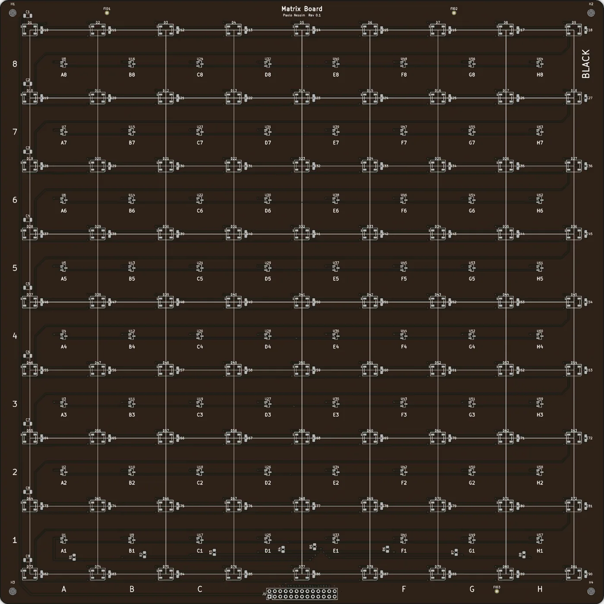
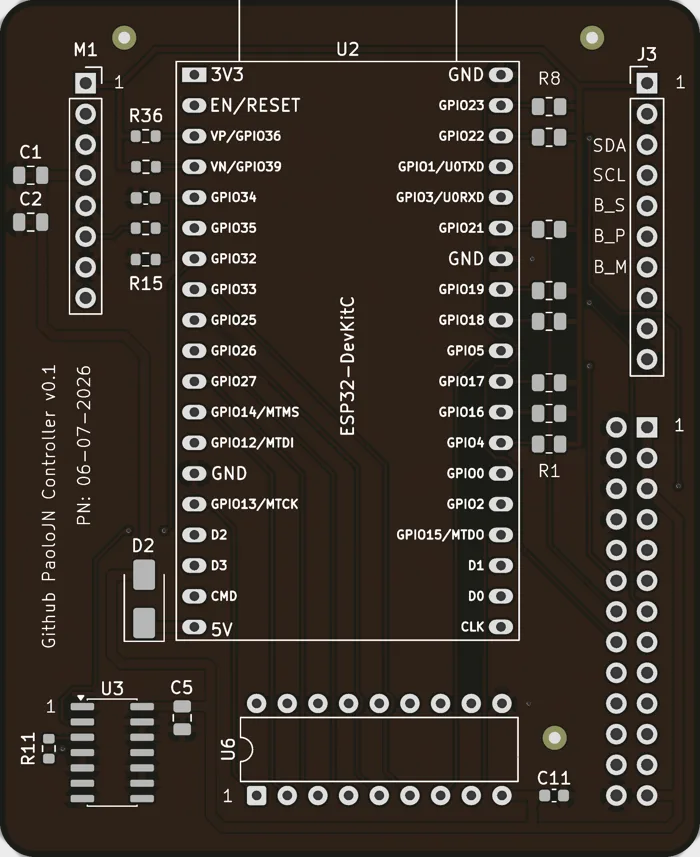

<h1 align="center">OpenChess</h1>

<p align="center">
  A chessboard that knows where the pieces are.<br>
  64 Hall sensors, 81 RGB LEDs, one ESP32, a 3D-printed case, and a phone app.<br>
  Designed in KiCad, assembled by JLCPCB and by hand, built once, for one desk.
</p>

<p align="center">
  <a href="STATUS.md">Status</a> ·
  <a href="#how-it-works">How it works</a> ·
  <a href="#repository-map">Repo map</a> ·
  <a href="#build-notes">Build notes</a> ·
  <a href="#licenses">Licenses</a>
</p>

<p align="center">
  
  &nbsp;&nbsp;
  
</p>

---

## What this is

A one-off, hands-on learning project, built during my year-long internship at
UMD CPSE. I had never designed a PCB before this. The goal was never a
product. It was to get one physical board that:

- detects every piece on every square with a magnet under each piece,
- shows legal moves, hints, and errors with LEDs at the square corners,
- plays offline against its own chess engine with a little OLED menu,
- talks to a companion phone app over Bluetooth,
- lives in a clean printed case with a swappable top plate.

The first boards came back from JLCPCB in June 2026 and worked on the first
power-up. Everything since then has been firmware, the case, the app, and a
battery-module swap so it runs without a cable.

## How it works

**Sensing.** Each square has a DRV5032FC Hall-effect sensor under it. The
matrix is scanned one column at a time: the controller powers a column through
a TBD62783A high-side driver, then reads eight row lines. A full scan of the
board takes about 100 ms, fast enough to feel instant.

**Lights.** 81 WS2812B LEDs sit on the 9x9 grid of square corners, so one
square lights up as its four corners. The ESP32 drives the chain through a
74AHCT125 level shifter so the data line is a real 5 V signal. Frames go out
over I2S DMA so flash writes from Bluetooth cannot corrupt them mid-frame.

**Brain.** An ESP32 runs one non-blocking loop: sensor scan, game controller,
LED language, OLED menu, and a BLE server. The offline engine is a homebrew
alpha-beta search with quiescence, iterative deepening, piece-square tables,
and move ordering. It plays at a few selectable strengths and runs its own
native unit tests on the desktop.

**UI.** A 0.91" SSD1306 OLED and three buttons on the front wall of the case
for menus, plus a React Native app that pairs over BLE, mirrors the board,
streams moves, and controls the LEDs.

**Case.** Designed in Fusion 360 around the real PCB STEP exports. The walls
and front panel print as one part, the top plate is swappable between a
two-color printed chessboard and a laser-cut plexi top, and the back cover
clamps the PCB stack with heat-set inserts.

## Where things stand

| Area | State |
|---|---|
| Matrix board v0.1 | Built, all 64 sensors and 81 LEDs verified on hardware |
| Controller v0.1 | Built, works on USB. The stock battery module shuts its boost down under light load, so it is being replaced with a bq25185 charger/boost |
| Controller v2 | Shelved. An integrated ESP32-WROOM-32E, USB-C, charger, and boost design got as far as a clean schematic, then the v0.1 board proved good enough |
| Firmware | Integrated product build: OLED menu, offline AI, coaching lights, BLE. Desktop-tested, hardware verification ongoing |
| Companion app | Expo app, all screens built, real BLE pairing works end to end on an iPhone |
| Case | Final print package exported, corner test piece printed and iterated through v9 |
| Robot arm | Side quest: the board drives a Waveshare RoArm-M2-S over ESP-NOW, with a DIY servo gripper |

The detailed, dated list of next actions lives in [`STATUS.md`](STATUS.md).

## Repository map

```text
openchess/
├── hardware/
│   ├── hardware-board/          8x8 matrix PCB, 282 x 282 mm (KiCad, gerbers, JLC BOM/CPL)
│   ├── hardware-controller/     controller v0.1, DevKitC + Lipo Rider (frozen, boards exist)
│   ├── hardware-controller-v2/  shelved v2 design, schematic only, kept for reference
│   └── DESIGN_NOTES.md          design rationale and history for the v0.1 boards
├── firmware/                    PlatformIO ESP32 firmware: engine, UI, BLE, bench sketches
├── app/                         Expo / React Native companion app (BLE)
├── mechanical/                  Fusion 360 case, print package, plexi top, test pieces
├── firmware-roarm/              vendored RoArm-M2-S firmware with the gripper patch
├── docs/                        GPIO map, connector contracts, BOM, design specs
├── scripts/                     PDF tiling helpers, robot-arm console
└── references/                  upstream projects this builds on (git-ignored clones)
```

## Build notes

**Hardware.** Open the KiCad projects under `hardware/`. The v0.1 boards were
fabricated and SMD-assembled by JLCPCB using the Fabrication Toolkit plugin
exports in each board's `production/` folder. The DevKitC, Lipo Rider, column
driver, and connectors were hand-soldered.

**Firmware.**

```bash
cd firmware
pio run -e esp32dev -t upload      # the integrated product build
pio run -e bench_sensor -t upload  # or any bench sketch from src/bench/
pio test -e native_ai              # engine unit tests on the desktop
```

The GPIO map lives in `firmware/src/pins.h` and `docs/gpio-map.md`. On the
v0.1 controller the OLED shares the UART0 pins, so unplug the OLED to flash.

**App.**

```bash
cd app
npm install
npx expo run:ios        # BLE needs a native dev build, not Expo Go
```

**Case.** Print files and the screw list are in `mechanical/exports/README.md`.
Print the corner test piece first.

## Built on

- [joojoooo/OpenChess](https://github.com/joojoooo/OpenChess): the firmware
  started as an adaptation of this engine and board driver.
- [omercier01/Chessboard](https://github.com/omercier01/Chessboard): the v1
  board this rebuild started from.
- [waveshareteam/roarm_m2](https://github.com/waveshareteam/roarm_m2): the
  robot arm firmware, vendored with a small gripper patch.

## Licenses

| Part | License |
|---|---|
| Hardware (`hardware/`, `mechanical/`) | [CERN-OHL-S v2](LICENSE-hardware) |
| Firmware and app (`firmware/`, `app/`) | [MIT](LICENSE-firmware) |
| Documentation | [CC-BY-4.0](LICENSE-docs) |
| `firmware-roarm/` | Upstream Waveshare license, see its `LICENSE` |
